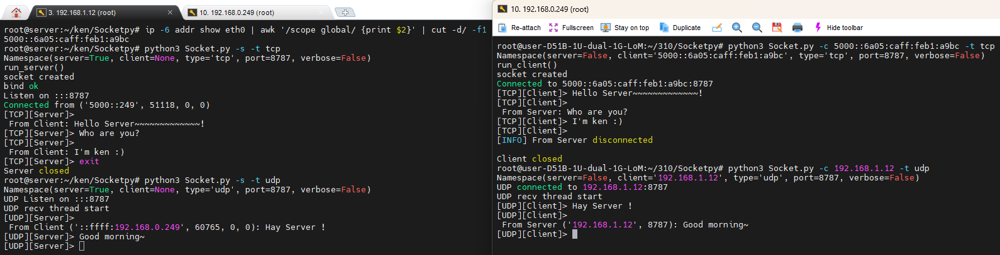

# Socket-Python

An interactive TCP/UDP socket command-line tool built with the Python standard library. Start a server and a client, then type text in the terminal to send messages back and forth.



## Features

- Supports both TCP and UDP.
- Runs in either server or client mode.
- Supports IPv4 and IPv6 addresses; the client detects the address family from the IP you provide.
- Uses port `8787` by default.
- No third-party Python packages required.

## Requirements

- Python 3
- An operating system with IPv6 support (the server listens on the IPv6 wildcard address `::` with `IPV6_V6ONLY` disabled, so a single port accepts both IPv4 and IPv6 connections)

## Usage

Run the following from the project root:

```bash
python3 Socket.py [mode] [options]
```

> On Windows you can use `py`, `python`, or `python3`; on macOS / Linux, `python3` is typical.

### Server

Start a server on the default TCP port `8787`:

```bash
python3 Socket.py --server
```

Start a UDP server:

```bash
python3 Socket.py --server --type udp
```

Use a custom port:

```bash
python3 Socket.py --server --type tcp --port 9000
```

> The server always listens on `::`; there is currently no option to choose the listening address.

### Client

Connect to a TCP server on the local machine:

```bash
python3 Socket.py --client 127.0.0.1
```

Connect to a UDP server at a specific IPv4 address:

```bash
python3 Socket.py --client 192.168.1.20 --type udp
```

Use a custom port or an IPv6 address:

```bash
python3 Socket.py --client 2001:db8::1 --type tcp --port 9000
```

> The client requires an IP address. Hostnames (such as `localhost` or domain names) are not supported; passing a non-IP string produces an `Invalid IP address` error.

### Options

| Option | Description |
| --- | --- |
| `-s`, `--server` | Run in server mode |
| `-c IP`, `--client IP` | Run in client mode and specify the server IP address |
| `-t`, `--type` | Protocol: `tcp` or `udp` (default: `tcp`) |
| `-p`, `--port` | Port number (default: `8787`) |
| `-v`, `--verbose` | Verbose mode flag (currently produces no extra output; see Notes) |
| `-h`, `--help` | Show help |

Exactly one of server mode or client mode must be chosen. To see the command-line help:

```bash
python3 Socket.py --help
```

## Interactive Use

1. Start the server in one terminal.
2. In another terminal, start the client with the same protocol and port.
3. Type text at the prompt on either side and press Enter to send it.
4. Type `exit` to quit that side.
5. If the peer has disconnected (TCP prints `[INFO] ... disconnected`), the input prompt is still waiting, so press Enter once more to exit the program.

To connect from another machine, use an IP address the server is reachable at, and make sure the firewall allows TCP or UDP traffic on the chosen port.

## Demo

In the screenshot above, the left terminal is the server (`192.168.1.12`) and the right terminal is the client (`192.168.0.249`). It shows two scenarios in order:

1. **TCP over IPv6**: the server starts with `-s -t tcp` and the client connects with `-c <server IPv6 address> -t tcp`. After exchanging messages, the server types `exit`, and the client prints `From Server disconnected` and exits.
2. **UDP over IPv4**: the server starts with `-s -t udp` and the client sends messages with `-c 192.168.1.12 -t udp`. Because the server uses a dual-stack IPv6 socket, the IPv4 client's address is displayed in IPv4-mapped form, for example `::ffff:192.168.0.249`.

## Project Structure

```text
.
├── Socket.py                 # Command-line entry point
├── README.md                 # Project documentation
├── sync.sh                   # Sync script (Linux / macOS)
├── w_sync.cmd                # Sync script (Windows)
├── docs/
│   └── demo.png              # Demo screenshot used in this README
└── func/
    ├── args_parse.py         # Command-line argument parsing
    ├── config.py             # Default port and prompt strings
    ├── ip_handler/
    │   └── sk_ip.py          # IP address and address-family detection
    ├── protocols/            # TCP/UDP clients and servers
    │   ├── TCP_Client.py
    │   ├── TCP_Server.py
    │   ├── UDP_Client.py
    │   └── UDP_Server.py
    ├── send_recv/            # Message sending and receiving
    │   ├── sk_recv.py
    │   └── sk_send.py
    └── ths/                  # Receiver threads
        ├── sk_thread_tcp.py
        └── sk_thread_udp.py
```

## Notes

- The TCP server currently accepts a single client connection. When that client disconnects, the server exits as well; restart it to accept another client.
- UDP is connectionless. The `UDP connected to ...` message printed by the client is only informational and does not mean the server is running or reachable.
- The UDP server remembers the most recent client that sent it a packet and replies to that client. Until the first client packet arrives, anything typed on the server side is not sent, and no warning is shown.
- The receive buffer is 1024 bytes per read. TCP is a stream protocol with no built-in message boundaries, so under heavy or rapid sending a single read may not match exactly one typed message. For UDP, packets larger than the buffer may be truncated or cause a receive error.
- `--verbose` currently exists only as a command-line option; the program does not yet produce any additional verbose output.
